# Hall-Effect Speed Sensor · Repair & Calibration

Diagnosis, repair and calibration of a failed Hall-effect speed sensor on an automotive lab training module: new sensor sourced without a datasheet, wiring harness rebuilt by hand, a signal-level mismatch solved with a custom voltage divider, and the result calibrated against an oscilloscope and a multimeter.

Solo project for the **Automotive Electrical Systems** course at Warsaw University of Technology (2026). I was handed the broken module and did the diagnosis, sourcing, rebuild, troubleshooting and calibration myself.

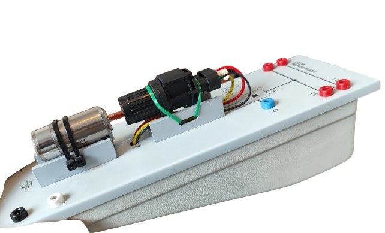

## The job

The lab module is a 12 V DC motor with a magnetic target ring on its shaft and a Hall-effect speed sensor that reads it. The original sensor was dead. Taking it apart showed no visible external damage, which pointed to a failed internal IC, so repairing the chip was off the table and the sensor had to be replaced.

## What I did

- **Diagnosis:** disassembled the failed sensor and narrowed the fault down to the internal IC
- **Sourcing:** with no reliable datasheet for the original part, picked and bought two candidate aftermarket automotive speed sensors, then verified one and mapped its pinout on a separate test rig before installing anything
- **Harness:** removed the damaged wiring block and hand-soldered a new harness
- **Troubleshooting:** found why the new sensor gave no readable output and built a fix in the lab
- **Calibration:** measured the sensor's response across the motor's whole speed range

## How the sensor works

As the motor turns, the magnetic ring spins past the stationary sensor. The alternating north and south poles change the magnetic flux, and the sensor turns that into a digital square wave. Count the pulses per second and you have the speed:

```
n = (f × 60) / P = (f × 60) / 6 = 10 · f
```

where `n` is speed in RPM, `f` is the output frequency in Hz and `P` is the number of pulses per revolution (6 on this ring, see below).

**Sensor pinout (mapped on the test rig):** left pin 12 V supply · middle pin digital data output · right pin ground.

## The build

| Lab module wiring | Rebuilt rear harness |
|---|---|
| 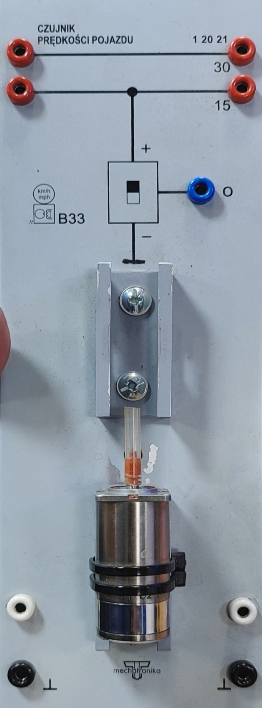 | 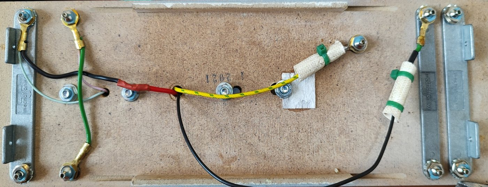 |

New wires of matching gauge were hand-soldered to the terminals, then protected with heat shrink and extra sleeving against shorts and strain. I checked every new joint with a meter: **all under 0.05 Ω**. The male pins were finished with crimp connectors.

| Finished pin connections | Sensor connector |
|---|---|
| 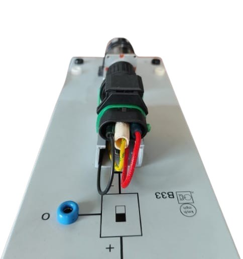 | 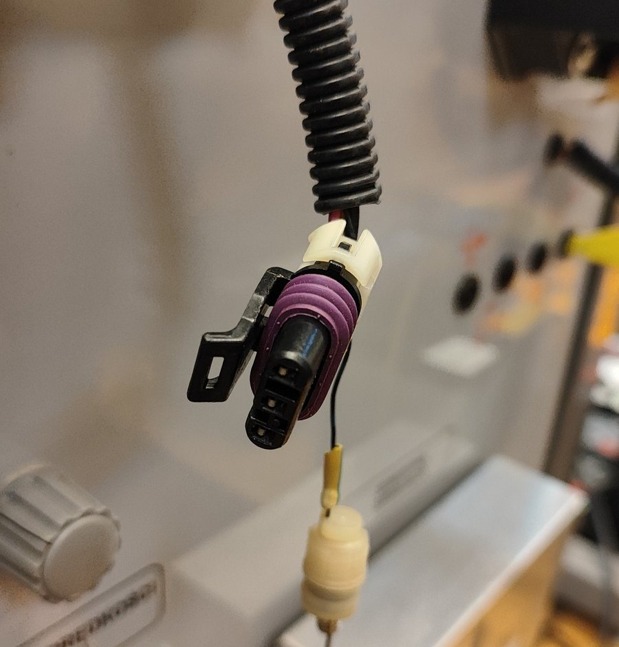 |

## Troubleshooting: the 12 V vs 7 V problem

With everything wired, the module still gave no readable output. The system runs on 12 V, but the sensor's data line works at a 7 V logic level, and unlike the original part, the aftermarket sensor has no internal voltage regulation to bridge the two.

A commercial adapter (for example a start/stop emulator module) would have solved it, but cost and shipping time ruled it out. Instead I built a **resistor voltage divider** in the lab, from a resistor board and a decade resistance box, to bring the 12 V system down to the 7 V the signal needs.

| Divider: resistor board side | Divider: decade resistance box side |
|---|---|
| 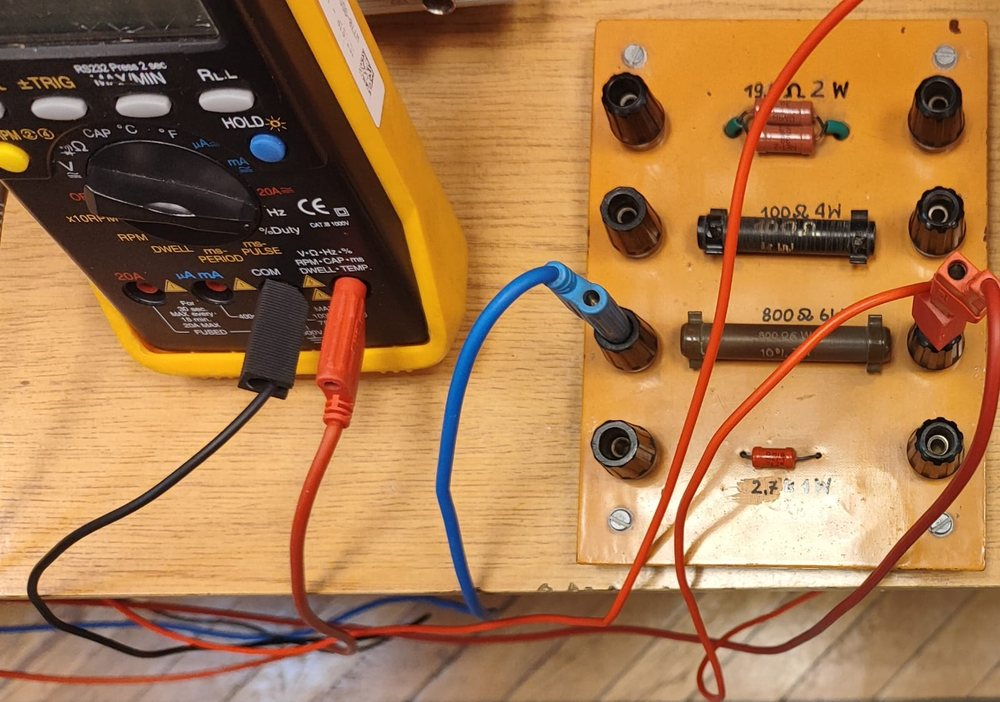 | 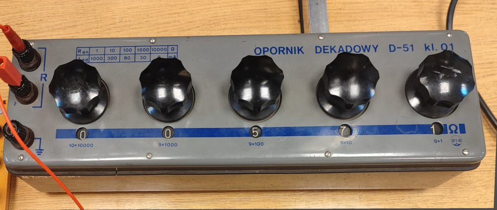 |

After the divider went in, the sensor produced a clean, readable signal.

## Calibration and results

**Pulses per revolution.** Turning the shaft by hand through exactly one revolution while watching the oscilloscope gave 6 pulses, so the ring has 6 poles and `n = 10 · f`.

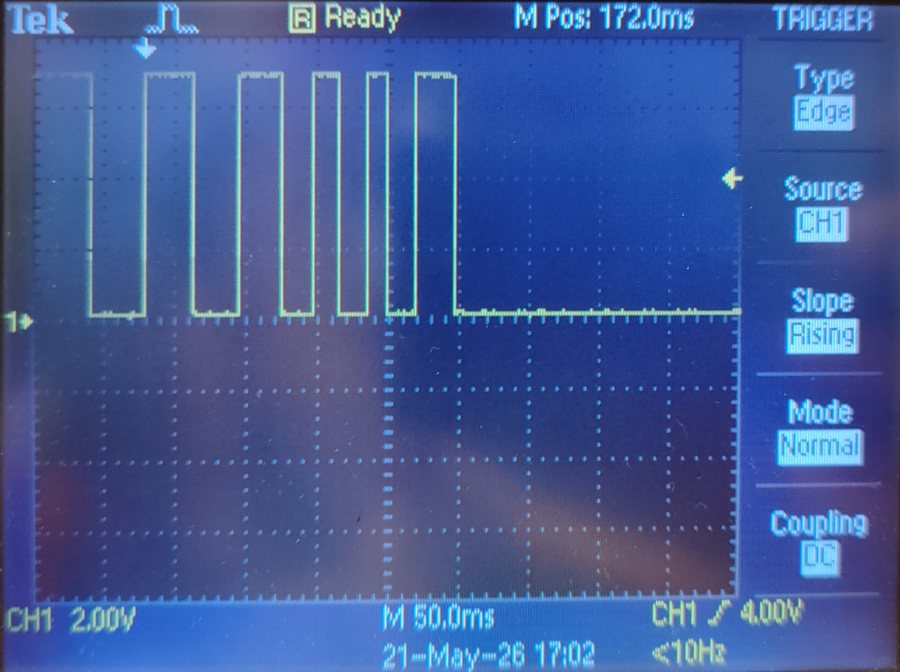

**Speed sweep.** I stepped the motor supply from 5 V to 12 V in 0.5 V steps and read the output frequency on both an oscilloscope and a multimeter.

| Motor voltage [V] | Oscilloscope [Hz] | Multimeter [Hz] | Speed [RPM] (scope) |
|---|---|---|---|
| 5.0 | 56 | 50 | 560 |
| 5.5 | 60 | 65 | 600 |
| 6.0 | 76 | 78 | 760 |
| 6.5 | 96 | 96 | 960 |
| 7.0 | 114 | 117 | 1140 |
| 7.5 | 128 | 130 | 1280 |
| 8.0 | 141 | 148 | 1410 |
| 8.5 | 168 | 166 | 1680 |
| 9.0 | 179 | 178 | 1790 |
| 9.5 | 201 | 199 | 2010 |
| 10.0 | 220 | 215 | 2200 |
| 10.5 | 235 | 235 | 2350 |
| 11.0 | 256 | 250 | 2560 |
| 11.5 | 265 | 265 | 2650 |
| 12.0 | 280 | 280 | 2800 |

Raw data: [`data/measurements.csv`](data/measurements.csv)

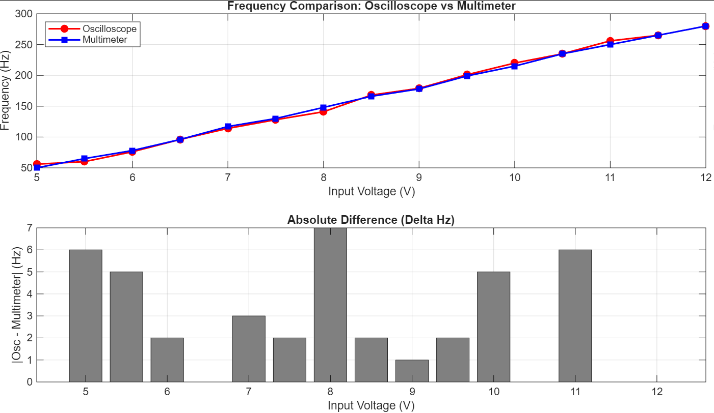

**What the data shows**

- Speed rises linearly with motor voltage: about **34 Hz (≈340 RPM) per volt**, with a straight-line fit of R² ≈ 0.997.
- The two instruments agree within **7 Hz** over the whole range, and within 5% from 6 V upward.
- At 5 V, the lowest voltage at which the motor turns at all, the square wave is uneven. That most likely comes from the motor struggling at its starting threshold rather than from the sensor. The waveform gets cleaner as speed rises, and from about 8.5 V up it is a stable, uniform square wave.

| 5 V | 7.5 V |
|---|---|
| 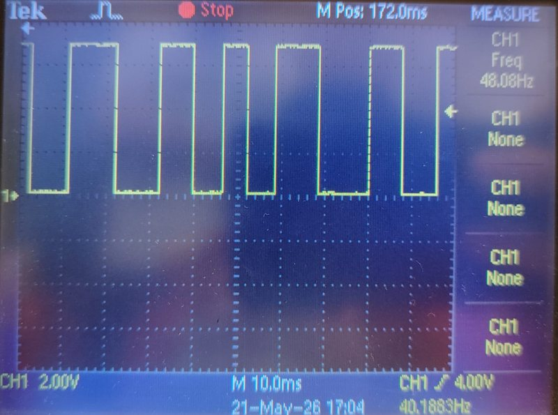 | 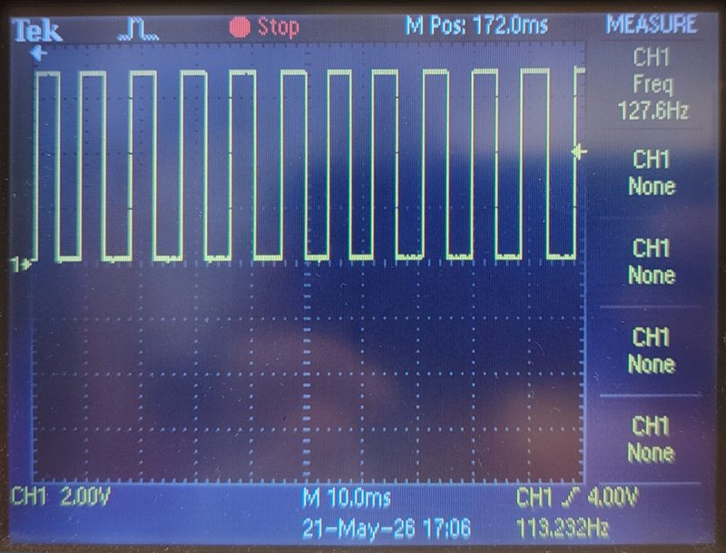 |
| **8.5 V** | **12.3 V** |
| 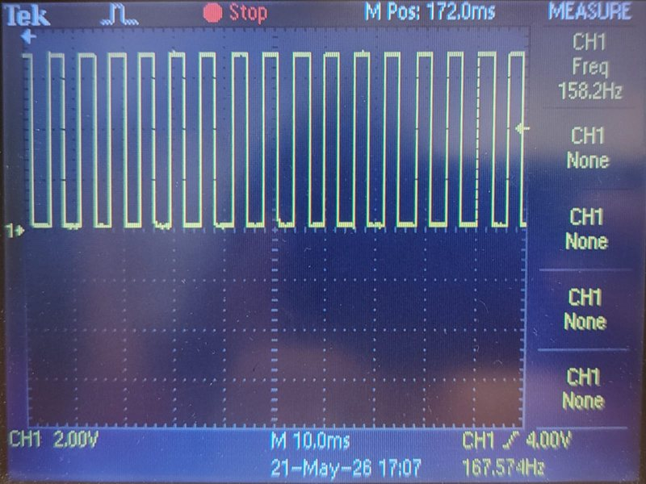 | 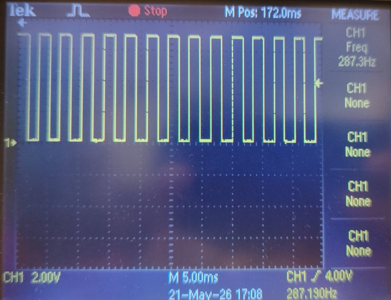 |

## What I would improve

- **Use a proper level shifter.** A resistor divider works, but its output depends on the load. A transistor stage with a pull-up, or a small regulator for the sensor supply, would hold the logic level steady.
- **Log automatically.** Reading frequency off the instruments by hand limits resolution. A microcontroller counting pulses with timestamps would give continuous, repeatable speed data.
- **Pin down the low-speed behaviour.** Driving the motor from a regulated PWM controller would separate motor effects from sensor effects at low RPM.

## Repository contents

```
docs/hall_sensor_repair_report.pdf   Full project report (LaTeX)
data/measurements.csv                Voltage, frequency and speed measurements
images/                              Build photos, oscilloscope captures and plots
```

## Tools

Soldering iron, heat shrink and crimping tools, multimeter, Tektronix oscilloscope, decade resistance box, MATLAB for the plots, LaTeX for the report.
